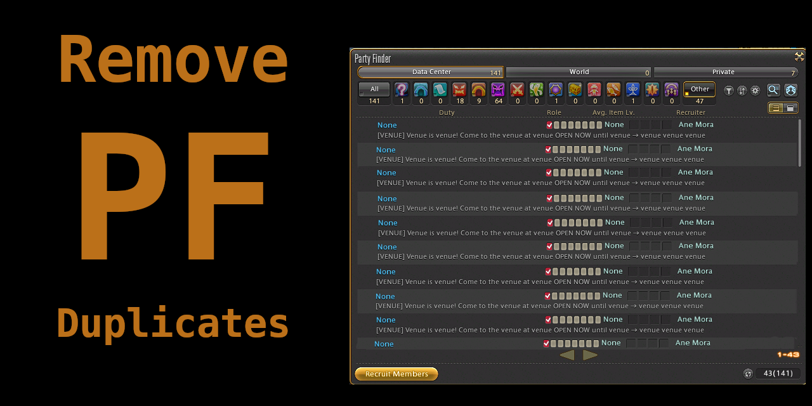

# Remove PF Duplicates

A [Dalamud](https://github.com/goatcorp/Dalamud) plugin that hides duplicate Party Finder ads in FINAL FANTASY XIV (FFXIV / FF14). When the same ad is posted again and again, as often happens with spam, venue ads and recruitment ads, you see it **once**, marked with how many copies there were.

There are no settings: enable it and open Party Finder.

## What it does

- **Treats ads as copies when their descriptions start with the same 30 characters**, so an ad reposted with a different time still counts ([why](docs/party-finder-notes.md#design-decision-match-on-the-first-30-characters-42)). Shorter descriptions must match exactly, and empty ones are left alone.
- **Shows each ad once.** The first copy you come across stays visible; every other copy is hidden, on every page.
- **Marks it with how many copies were found,** e.g. $\color{orange}{\texttt{[3]}}$ `Come to my venue tonight…`. Copies on other pages of the same search count too, and each listing is only counted once.
- **Shows how many are hidden on the current page** in the window title, e.g. `Party Finder` $\color{orange}{\texttt{(7 duplicates hidden)}}$.
- **Starts over with each new search:** opening the window, Refresh or a new category. Next and Previous keep counting.

It only changes what the Party Finder list and title show, and never sends anything to the server. Turning it off puts the window back to normal; hidden copies reappear the next time the list refreshes.

## Works with other Party Finder plugins

Tested alongside [NoSoliciting](https://github.com/Noevain/NoSoliciting) and [Better Party Finder](https://github.com/Infiziert90/BetterPartyFinder). It never shows a listing another plugin has hidden. Details are in [the compatibility notes](docs/party-finder-notes.md#compatibility-with-other-party-finder-plugins-28).

## Problems or ideas

Please [report a bug](https://github.com/pearstopher/FFXIV-Remove-PF-Duplicates/issues/new?template=bug.md). The form asks for your versions, what happened, and the relevant lines from `dalamud.log`, which makes problems much quicker to fix.

## Contributing

- **Building and testing:** see [DEVELOPMENT.md](DEVELOPMENT.md). It covers the .NET 10 SDK, building, loading a dev build in game, unit tests (`dotnet test`), and the in-game checks in [docs/in-game-testing.md](docs/in-game-testing.md) and [docs/manual-tests.md](docs/manual-tests.md).
- **Releasing:** push a version tag such as `v1.0.1`; GitHub Actions builds it, publishes the release and updates `repo.json` ([DEVELOPMENT.md, section 8](DEVELOPMENT.md#8-releasing-a-new-version)).
- **After game or Dalamud patches:** see the patch-day checklist ([DEVELOPMENT.md, section 9](DEVELOPMENT.md#9-staying-up-to-date-after-patches)).
- **How it works:** a plain-language tour of the code that runs in game is in [docs/how-the-code-works.md](docs/how-the-code-works.md). Research and design decisions are in [docs/party-finder-notes.md](docs/party-finder-notes.md).

## License

Licensed under the [GNU Affero General Public License v3.0](LICENSE.md), the same license as [goatcorp/SamplePlugin](https://github.com/goatcorp/SamplePlugin), which this plugin was scaffolded from.
